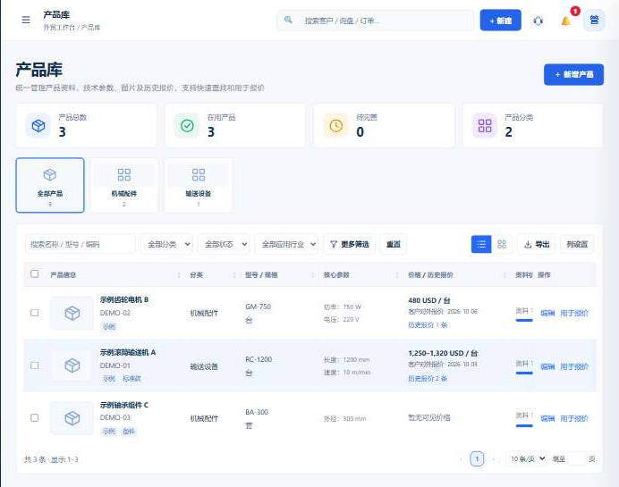

# Changelog

## 2026-10-15 · 询盘登记与最新业务更新

- 同步询盘草稿箱、个人 MCP 接入、原文核对、来源去重、补充字段与正式登记。
- 支持草稿关联既有询盘、询盘详情和历史分页，保留原文及人工维护的状态。
- 同步报价自动关联询盘、报价版本合并及关联记录保护。
- 同步产品目录分类图片、参数编辑和附件维护、导航图标及最新界面调整。
- 保留开源版的通用部署配置、MIT 许可证和合成测试数据；MCP 下载包重新脱敏生成。

## 2026-10-10 · 产品目录与历史报价

- 新增产品库列表与卡片视图、分类导航、规格摘要、筛选、分页、CSV 导出和详情面板。
- 支持维护产品参数、标签、行业和附件，并按账号权限查看相关客户与历史报价。
- 支持从 CSV / JSON 预览并导入历史报价，整理费用与待确认明细，避免重复导入。
- 报价可以关联产品和同币种历史价格；已保存报价保留产品内容快照。
- 修复 MySQL 模式下产品目录设置的持久化注册。
- 脱敏界面截图仅使用合成产品与价格数据，不含真实客户、员工或收款资料：
  

## 2026-09-30 · 首个公开版本

- 发布通用外贸 CRM：客户、询盘、报价、订单、单证、业绩、任务与沟通记录。
- 支持自托管、按用户权限隔离、可选 AI 文档录入和 JSON / MySQL 存储。
- 移除部署实例的业务数据、身份信息、内部路径及不随 MIT 版本分发的 3D 装箱模块。
